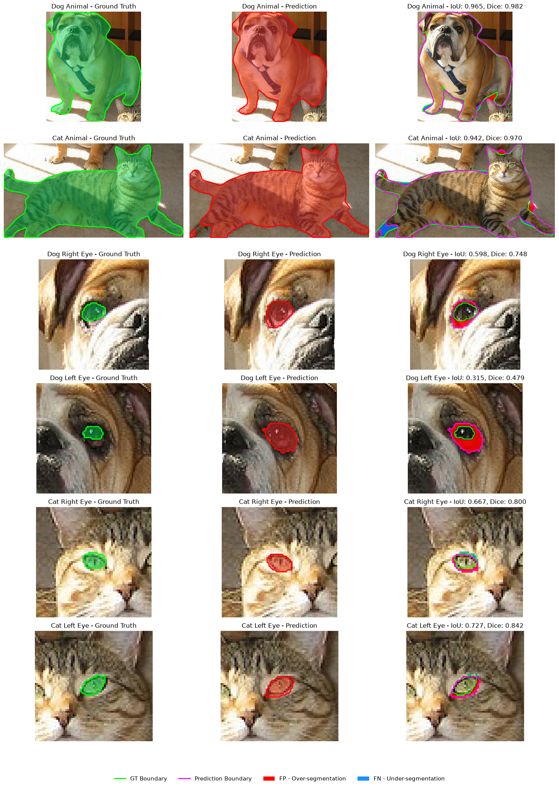
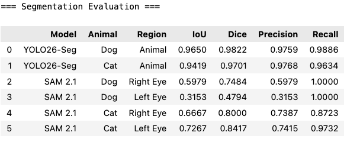
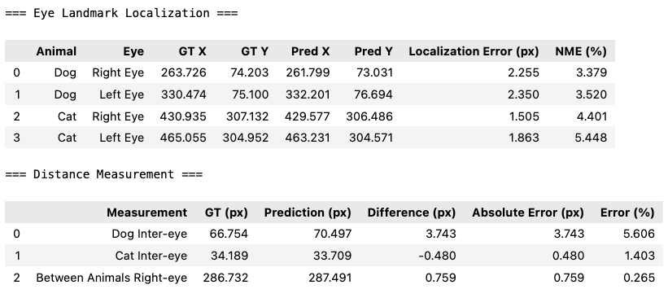
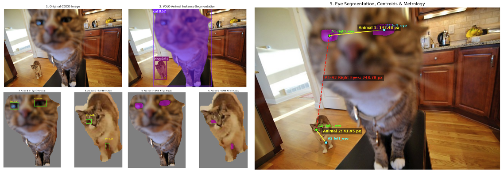
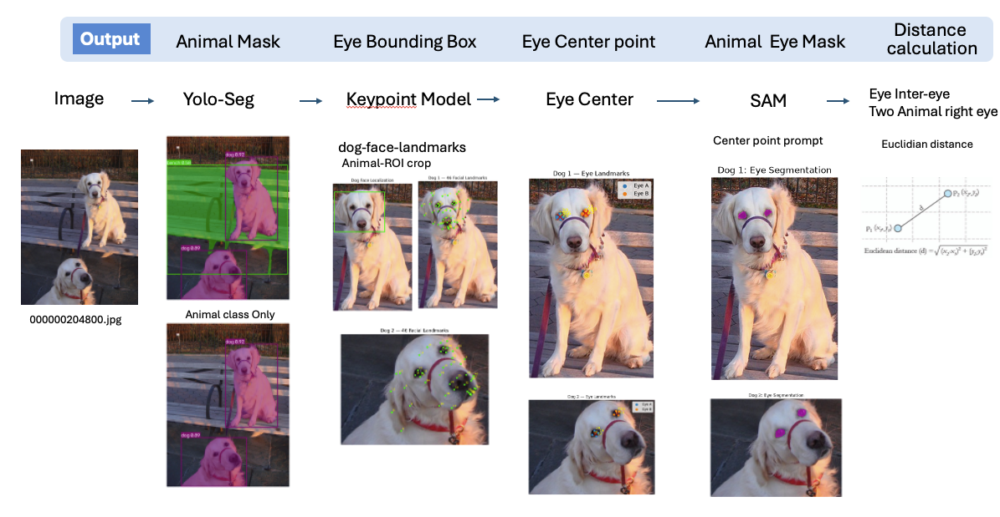

# COCO 動物眼睛影像分割與幾何量測

**Animal Eye Segmentation and Metrology Using YOLO, Grounding DINO, and SAM 2**

## 1. 專案簡介（Introduction）

本專案探討如何將深度學習影像分割（Image Segmentation）模型的輸出，應用於實際幾何量測（Metrology）任務。

基於 COCO 動物影像，整合實例分割、眼睛定位與幾何距離量測，並透過人工 Ground Truth 評估量測誤差。


### 專案目標

1. 從 COCO 資料集中選擇包含至少兩隻動物的影像。
2. 使用 Instance Segmentation 模型分割每隻動物的輪廓。
3. 使用眼睛偵測及分割模型取得每隻動物的左右眼 Mask。
4. 利用眼睛 Mask 的幾何中心量測：
   - 每隻動物的左右眼距離（Inter-eye Distance）。
   - 任意兩隻動物的右眼中心距離（Between-animal Right-eye Distance）。
5. 建立人工標註的 Ground Truth，驗證分割與量測結果。
6. 分析模型預測誤差對實際 Metrology 任務的影響。


## 2. 資料集（Dataset）

### 2.1 資料選擇

本專案共挑選 **7 張包含至少兩隻動物的 COCO 影像**，用於驗證模型在不同動物類別、數量、影像尺度及拍攝條件下的表現。

主要挑選條件如下：

- 每張影像至少包含兩隻動物。
- 優先選擇雙眼可見的動物，以利眼睛定位及距離量測。
- 包含不同類別與數量的動物，測試方法的適用性。
- 額外考慮模糊、動物尺度差異及部分遮擋等情況。

資料來源：[COCO 2017 Segmentation — Ultralytics](https://platform.ultralytics.com/ultralytics/datasets/coco2017-seg)


### 2.2 測試影像

| Image ID | 動物組成 | 用途 |
|---|---|---|
| `000000204800` | 2 Dogs | 雙動物分割與眼距量測 |
| `000000114269` | 1 Dog + 1 Cat | **主要定量驗證案例（Ground Truth Evaluation）** |
| `000000319062` | 2 Dog | 半臉跟全臉 |
| `000000169426` | 4 Animals | 多動物距離量測 |
| `000000017179` | 2 Cats | 模糊影像與失敗案例 |
| 其餘測試影像 | 不同動物組合 | 定性展示與模型穩健性觀察 |


完整推論程式與其他測試案例可參考 src.ipynb。

### 2.3 Ground Truth 與評估策略

七張圖片用於展示模型的完整預測流程，其中選擇 `000000114269`（Dog + Cat）建立人工 Ground Truth，作為主要定量評估案例。

選擇原因： 相較於兩隻狗的簡單案例，此影像包含不同動物類別（Dog & Cat），且動物的 Bounding Boxes 部分重疊，增加了 Instance Segmentation 與 Eye Detection 的挑戰性。同時，兩隻動物的眼睛仍清晰可辨，適合進行人工標註與誤差驗證。

因此，本案例可視為**中等難度（Moderate Difficulty）**的測試場景，在模型挑戰性與 Ground Truth 標註可靠性之間取得平衡。

此影像包含：

- 2 個 Animal Instance Masks
- 4 個 Eye Segmentation Masks
- 4 個人工 Eye Center Landmarks
- 3 組距離量測（Dog 雙眼、Cat 雙眼、Dog 與 Cat 右眼）


## 3. 系統架構（Methodology）

本專案採用 **YOLO26n-Seg + Grounding DINO + SAM 2.1 Tiny**，透過三個模型完成動物實例分割、眼睛定位及眼睛分割，最後使用幾何運算進行距離量測。

### 3.1 模型選擇

| Model | 功能 | 選擇原因 |
|---|---|---|
| **YOLO26n-Seg** | Animal Detection & Instance Segmentation | 使用 COCO Pre-trained Model，可直接辨識 COCO 中的 10 種動物類別，並取得各動物的 Bounding Box 與 Instance Mask，無須額外訓練 |
| **Grounding DINO** | Eye Detection | 使用 Text Prompt 進行動物眼睛定位，不需額外訓練專用 Eye Detector |
| **SAM 2.1 Tiny** | Eye Segmentation | 使用 Eye Bounding Box 作為 Prompt，取得眼睛的精細 Segmentation Mask |

### 3.2 完整流程（Pipeline）

1. **Animal Detection & Segmentation**：使用 YOLO-Seg 偵測動物，取得每隻動物的 Bounding Box 與 Instance Mask。
2. **Animal ROI Extraction**：利用 Bounding Box 裁切動物，並透過 Instance Mask 去除背景及其他動物的干擾。
3. **Eye Detection**：使用 Grounding DINO 搭配 Text Prompt 偵測眼睛 Bounding Boxes，並以幾何條件過濾不合理候選框。
4. **Eye Segmentation**：將 Eye Bounding Boxes 作為 SAM 的 Prompts，產生左右眼 Binary Masks。
5. **Eye Centroid Extraction**：計算每個 Eye Mask 的幾何中心，並將 ROI 座標轉換回原始影像座標。
6. **Distance Measurement**：根據眼睛中心的 X 座標判斷左右眼，使用 Euclidean Distance 計算單隻動物的雙眼距離，以及不同動物之間的右眼距離。


### 3.3 幾何量測（Metrology）

**Eye Mask Centroid：** 以 Mask 所有前景像素的平均座標作為眼睛中心。

$$
C_x=\frac{\sum xM(x,y)}{\sum M(x,y)},\qquad
C_y=\frac{\sum yM(x,y)}{\sum M(x,y)}
$$

**Euclidean Distance：** 使用兩個眼睛中心座標計算距離。

$$
D(P_1,P_2)=\sqrt{(x_1-x_2)^2+(y_1-y_2)^2}
$$

- **Inter-eye Distance**：同一隻動物左右眼中心的距離。
- **Between-animal Right-eye Distance**：任意兩隻動物右眼中心的距離。

目前量測單位為 Pixel（px）。


## 4.  Evaluation

透過人工 Polygon Annotation 建立 Binary Mask Ground Truth，並與模型預測結果比較。

評估分成三個部分：

| 評估層級 | 評估內容 | Metrics | Main |
|---|---|---|---|
| Segmentation | 動物與眼睛 Mask | IoU、Precision、Recall | IoU：衡量 Prediction Mask 與 GT Mask 的重疊程度，驗證分割輪廓是否準確|
| Localization | 眼睛中心定位 | Euclidean Error、NME |Euclidean Error：衡量預測眼睛中心與 GT 中心的像素距離；NME 進一步以 GT 雙眼距離正規化，便於比較不同大小的動物。|
| Metrology | 眼睛之間的距離 | MAE、RMSE、MAPE |MAE：衡量模型量測距離與 GT 距離的平均絕對誤差；RMSE 強調較大誤差，MAPE 表示相對百分比誤差|


### Evaluation Metrics

**Segmentation IoU**

$$
IoU = \frac{TP}{TP+FP+FN}
$$

**Normalized Mean Error (NME)**

$$
NME = \frac{1}{N}\sum_{i=1}^{N}
\frac{\|\hat{P}_i-P_i\|_2}{D_{\text{GT, inter-eye}(i)}}
$$

**Distance Mean Absolute Error (MAE)**

$$
MAE = \frac{1}{N}\sum_{i=1}^{N}
|\hat{D}_i-D_i|
$$


### 4.1 Segmentation Evaluation



### 4.2 Eye Localization & Metrology Evaluation



### 4.3 Evaluation Results & Reproducibility

本專案僅針對 COCO Image `000000114269`（Dog + Cat）建立完整人工 Ground Truth，因此定量結果為單張影像的 Demo Evaluation，不代表整個 COCO 資料集的平均準確度。

模型實際輸出的評估結果已匯出為 **CSV 檔案**，存放於 [`results/`](results/) 資料夾，包含：

- Segmentation Metrics
- Eye Landmark Localization Metrics
- Distance Measurement Metrics

完整評估程式、計算過程與視覺化結果請參考 [`evaluation.ipynb`](evaluation.ipynb)。

## 5. Conclusion

本專案結合 YOLO26-Seg、Grounding DINO 與 SAM 2.1，實現從多動物影像分割、眼睛定位到幾何距離量測的完整流程。

透過 Segmentation、Localization 和 Metrology 三個層級的 Ground Truth 驗證，可以分別分析分割品質、眼睛中心誤差，以及最終距離量測的準確度。


## 實作與環境建置（Installation & Usage）

本專案使用 **Python 3.11 + Conda**，環境名稱為 `animal-metrology`。

### 1. 建立 Conda 環境

```bash
conda create -n animal-metrology python=3.11 -y
conda activate animal-metrology
```

### 2. 安裝所需套件

使用 `requirements-lock.txt` 安裝本專案使用的 Python 套件版本：

```bash
python -m pip install -r requirements-lock.txt
```


### 3. 執行專案

本專案提供 Jupyter Notebook 與 Python CLI 兩種執行方式。

| File | 功能 |
|---|---|
| `main.py` | **Command Line Inference**：執行完整 YOLO → Grounding DINO → SAM → Distance Measurement Pipeline，並匯出 CSV、JSON 與視覺化圖片 |
| `src.ipynb` | 模型推論、眼睛分割與距離量測的開發及實驗 |
| `annotation.ipynb` | 人工 Ground Truth 標註 |
| `evaluation.ipynb` | Segmentation、Localization 與 Metrology 定量評估 |

**Command Line Inference**

可直接透過 Terminal 執行完整推論流程：

```bash
python main.py \
  --image images/000000114269.jpg \
  --output results/demo
```

推論完成後，結果將儲存於指定的 Output Directory：

- `*_distances.csv`：雙眼距離與跨動物右眼距離
- `*_measurements.json`：動物類別、眼睛中心座標與量測結果
- `*_preview.png`：眼睛位置及距離量測視覺化

> 模型權重與 COCO 測試影像需放置在程式指定的路徑下，才能正常執行。

### Deployment & API

本專案支援 **Conda 本地環境與 Python CLI 推論**，目前尚未封裝成 REST API 或 Docker Image。

- **Local Deployment**：使用 Conda 建立 Python 環境，透過 `main.py` 執行推論。
- **Docker**：尚未容器化，目前使用 Conda 執行。
- **API Documentation**：N/A（目前不提供 REST API）。
- **Test Account**：N/A（本地推論無須帳號登入）。
- **Environment Configuration**：參考 `.env.example`。

未來可將 CLI Pipeline 進一步封裝成 REST API 與 Docker Image，以支援跨平台部署。


## Future Work
- [ ] **Head Pose & Eye Orientation**：目前依據 Eye Centroid 的水平座標判斷左右眼，主要適用於近正面臉部。未來可結合 Facial Landmark 或 Head Pose Estimation，改善側臉、頭部旋轉及眼睛遮擋時的左右眼判斷。(Alternative keypoint model)
- [ ] Robustness：改善模糊、遮擋、小眼睛及眼睛候選框誤判等問題。
**Failure Case – Blurred Cat** 背景貓咪因失焦且眼睛尺寸過小，導致 Eye Detection 失敗。

- [ ] Multi-species Generalization：擴展至更多動物類別，目前 Animal Detection 僅涵蓋 YOLO COCO Pre-trained Model 的 10 種動物類別。
- [ ] Validation：擴充人工 Ground Truth 數量，評估不同影像條件下的量測誤差。
- [ ] Physical Metrology：加入相機校正與尺度資訊，將 Pixel Distance 延伸至實際物理量測。


## Other Possible Solution
另一種方法是使用 Dog Facial Landmark Model 取代 Grounding DINO 進行眼睛定位。
此方法使用眼睛 Landmark 作為 SAM 的 Point Prompt，探索另一種眼睛定位與分割策略。

目前此方法主要針對狗臉部測試，尚未完成與主要方案在相同資料集上的定量比較。
YOLO-Seg → Animal ROI → Facial Landmark Model → Eye Center → SAM → Distance Measurement


