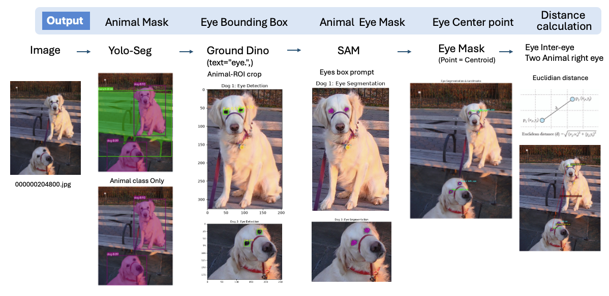
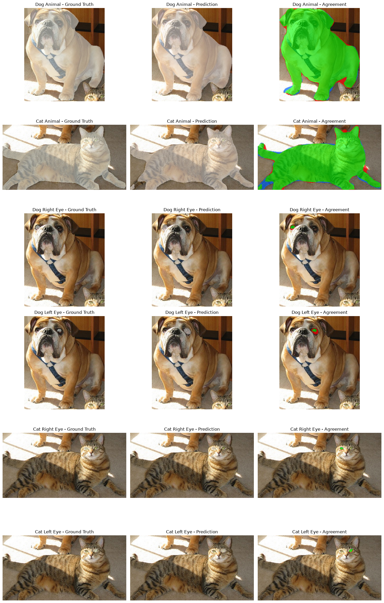
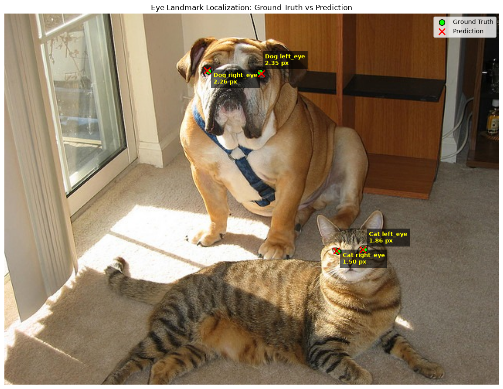
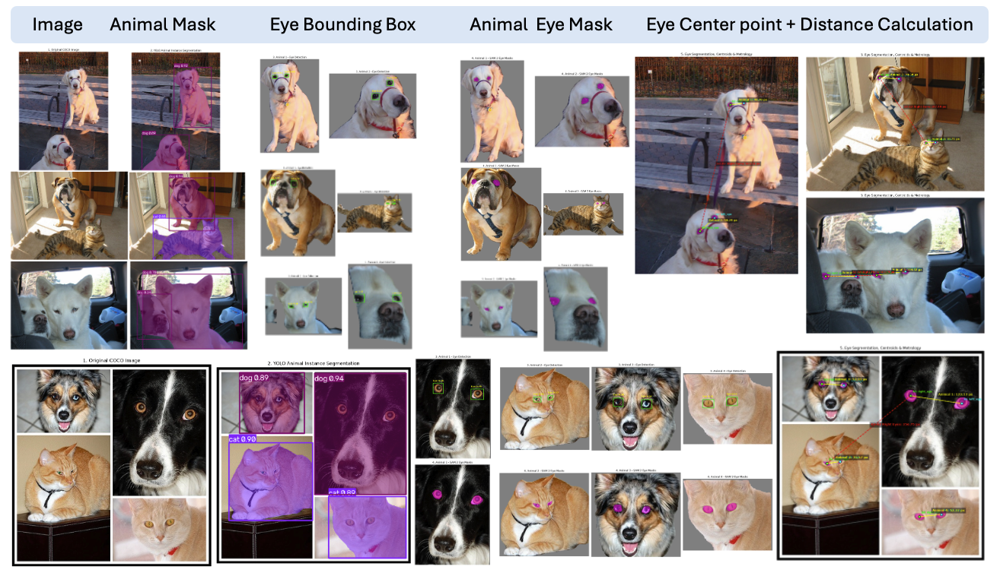

# COCO 動物眼睛影像分割與幾何量測

**Animal Eye Segmentation and Metrology Using YOLO, Grounding DINO, and SAM 2**

## 1. 專案簡介（Introduction）

本專案探討如何將深度學習影像分割（Image Segmentation）模型的輸出，應用於實際幾何量測（Metrology）任務。

以 COCO 資料集中的動物影像為例，建立一套由動物偵測、實例分割、眼睛定位、眼睛分割到距離量測的完整流程。

### 專案目標

1. 從 COCO 資料集中選擇包含至少兩隻動物的影像。
2. 使用 Instance Segmentation 模型分割每隻動物的輪廓。
3. 使用眼睛偵測及分割模型取得每隻動物的左右眼 Mask。
4. 利用眼睛 Mask 的幾何中心量測：
   - 每隻動物的左右眼距離（Inter-eye Distance）。
   - 任意兩隻動物的右眼中心距離（Between-animal Right-eye Distance）。
5. 建立人工標註的 Ground Truth，驗證分割與量測結果。
6. 分析模型預測誤差對實際 Metrology 任務的影響。

---

## 2. 資料集（Dataset）

### 2.1 資料選擇

本專案共挑選 **7 張包含至少兩隻動物的 COCO 影像**，用於驗證模型在不同動物類別、數量、影像尺度及拍攝條件下的表現。

主要挑選條件如下：

- 每張影像至少包含兩隻動物。
- 優先選擇雙眼可見的動物，以利眼睛定位及距離量測。
- 包含不同類別與數量的動物，測試方法的適用性。
- 額外考慮模糊、動物尺度差異及部分遮擋等情況。
資料集參考：[COCO 2017 Segmentation — Ultralytics](https://platform.ultralytics.com/ultralytics/datasets/coco2017-seg)

### 2.2 測試影像

| Image ID | 動物組成 | 用途 |
|---|---|---|
| `000000204800` | 2 Dogs | 雙動物分割與眼距量測 |
| `000000114269` | 1 Dog + 1 Cat | **主要定量驗證案例（Ground Truth Evaluation）** |
| `000000017179` | 2 Cats | Edge Case |
| 其他測試影像 | 4 Animals | 多動物距離量測 |
| 其他測試影像 | 2 Animals | 模糊影像與失敗案例 |
| 其餘測試影像 | 不同動物組合 | 定性展示與模型穩健性觀察 |

### 2.3 Ground Truth 與評估策略

七張圖片用於展示模型的完整預測流程，其中選擇 `000000114269`（Dog + Cat）建立人工 Ground Truth，作為主要定量評估案例。

此影像包含：

- 2 個 Animal Instance Masks
- 4 個 Eye Segmentation Masks
- 4 個人工 Eye Center Landmarks
- 3 組距離量測（Dog 雙眼、Cat 雙眼、Dog 與 Cat 右眼）

透過人工 Polygon Annotation 建立 Binary Mask Ground Truth，並與模型預測結果比較。

評估分成三個部分：

| 評估層級 | 評估內容 | Metrics |
|---|---|---|
| Segmentation | 動物與眼睛 Mask | IoU、Dice、Precision、Recall |
| Localization | 眼睛中心定位 | Euclidean Error、NME |
| Metrology | 眼睛之間的距離 | MAE、RMSE、MAPE |

由於目前僅針對一張影像建立完整的人工標註，因此定量結果代表該 Demo 的表現，不作為整個 COCO 資料集的整體準確率。

## 3. 系統架構（Methodology）

## 4.  Evlaution

